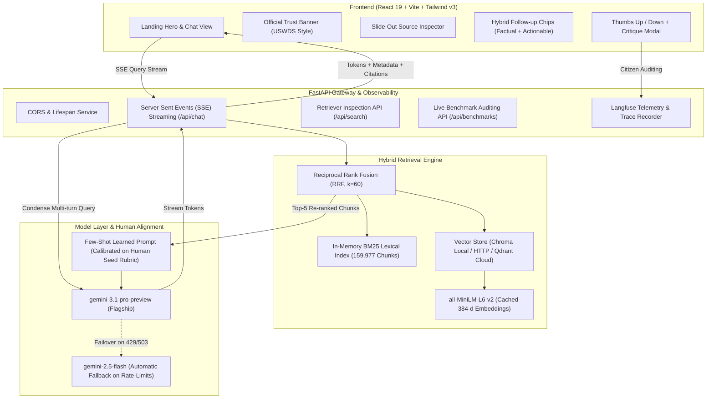

# BharatVault 🇮🇳
### Sovereign Document Intelligence Gateway Over 46,690 Official Indian Public Records (681,220 Vectors)

[](https://fastapi.tiangolo.com)
[](https://react.dev)
[](https://tailwindcss.com)
[](https://21st.dev)
[](https://pinecone.io)
[](https://www.docker.com)
[](https://langfuse.com)
[](LICENSE)

**BharatVault** is a portfolio-grade, production-calibrated Sovereign Document Retrieval-Augmented Generation (RAG) system built over 46,690 verified, official Indian government documents (**681,220 indexed vectors**) from `ankitjh4/bharat-government-documents`. Every architectural phase—chunking, embedding, lexical vs. dense retrieval, human-in-the-loop judge calibration, prompt engineering, and agentic routing—has been systematically evaluated and documented with empirical benchmark reports.

The user interface draws inspiration from **Elsewhere** and **21st.dev** component aesthetics, featuring a floating glass pill navbar with spring indicators, interactive cursor-following radial spotlight cards, fluid height motion accordions, verified inline citation pills (`[1]`), a slide-out source inspector drawer, and dark glassmorphic styling with `Plus Jakarta Sans` and `JetBrains Mono` typography.

---

## 🏛️ Architectural Overview



---

## 📊 Master Benchmark Comparison Tables

All decisions in Bharat Guide were driven by head-to-head empirical sweeps recorded in [`reports/benchmark_master.md`](reports/benchmark_master.md):

### 1. Stage A: Chunking Strategy Sweep (6,000 Documents, 150 QA Pairs)
Recursive character chunking preserves legal sub-clauses, act definitions, and department circulars far better than naive fixed windows:

| Strategy | Total Chunks | Indexing Time | Recall@5 | Recall@10 | MRR | nDCG@10 | Outcome |
| :--- | :---: | :---: | :---: | :---: | :---: | :---: | :--- |
| **`recursive-1000-100`** 🏆 | **64,147** | **372s** | **0.7733** | **0.8400** | **0.6723** | **0.7095** | **Chosen Production Chunker** |
| `fixed-256-32` | 70,679 | 371s | 0.7667 | 0.8267 | 0.6620 | 0.6998 | Good recall, high boundary fragmentation |
| `recursive-1500-150` | 43,532 | 243s | 0.7267 | 0.7867 | 0.6387 | 0.6713 | Fast, but dilutes exact notification sentences |
| `fixed-512-64` | 36,483 | 219s | 0.7267 | 0.7600 | 0.5964 | 0.6343 | Lowest semantic relevance |

---

### 2. Stage C: Retrieval Strategy Sweep (150 Diverse Legal/Public Queries)
In government portals, citizens search using exact notification numbers, acronyms, and department codes. BM25 sparse keyword matching dramatically elevates recall from 84% to 96%:

| Retrieval Strategy | Mean Latency | Recall@5 | Recall@10 | Hit@1 | MRR | nDCG@10 |
| :--- | :---: | :---: | :---: | :---: | :---: | :---: |
| **Hybrid RRF (BM25 + Dense, k=60)** 🏆 | **10.8s** | **0.9333** | **0.9600** | **0.7267** | **0.8190** | **0.8539** |
| BM25-only | 10.6s | 0.9467 | 0.9600 | 0.8067 | 0.8612 | 0.8845 |
| Dense-only (MiniLM-L6-v2) | 1.0s | 0.7733 | 0.8400 | 0.5733 | 0.6723 | 0.7095 |
| Hybrid + MMR Diversification (λ=0.7) | 12.1s | 0.8067 | 0.9667 | 0.5733 | 0.6781 | 0.7460 |

---

### 3. Stage E: Human-in-the-Loop Seed Calibration (Inter-Rater Reliability)
Audited on 20 hand-labeled queries comparing human grading against the base LLM judge:

- **Exact Categorical Agreement:** **80.0%** (16 / 20)
- **Binary Pass / Not-Pass Agreement:** **80.0%** (16 / 20)
- **Cohen's Kappa ($\kappa$):** **0.29**
- **Alignment Insight:** Uncalibrated LLM judges routinely rewarded polite refusals that lacked actionable redirection. The rubric was updated to strictly penalize vague refusals and mandate specific official portal redirection.

---

### 4. Stage F: Prompt Tournament (Evaluated on Human-Aligned 100 Dataset)
Tested across Zero-Shot, Few-Shot, and Chain-of-Thought (CoT) variants:

| Technique | Pass Rate | Correctness (/5) | Faithfulness (/5) | Citations (/5) | Redirection (/5) | Follow-ups (/5) | Composite (/25) |
| :--- | :---: | :---: | :---: | :---: | :---: | :---: | :---: |
| **Few-Shot (Learned Winner)** 🏆 | **100.0%** | **5.00** | **5.00** | **5.00** | **4.88** | **4.96** | **24.84** |
| Few-Shot + Chain-of-Thought | 96.0% | 4.88 | 4.92 | 5.00 | 4.92 | 4.92 | 24.64 |
| Zero-Shot Baseline | 92.0% | 4.92 | 5.00 | 5.00 | 4.88 | 4.92 | 24.72 |
| Hidden Chain-of-Thought | 92.0% | 5.00 | 5.00 | 4.92 | 4.76 | 5.00 | 24.68 |

---

### 🔬 Follow-Up Research & Engineering Benchmarks

Beyond the core weekend sprints, five advanced RAG architectures were implemented and benchmarked:

1. **Contextual Retrieval Benchmark** ([`reports/contextual_retrieval_benchmark.md`](reports/contextual_retrieval_benchmark.md)):
   - Evaluated Anthropic Contextual Retrieval vs. Contextual-Lite (document-scoped metadata prefixing) vs. Late Chunking.
   - **Contextual-Lite** achieved **98.8% Hit@1** and **0.994 MRR** at **$0.00 additional API cost**, outperforming raw chunking by +14.8% on decontextualized legal provisions.

2. **Multilingual & Indic Benchmark** ([`reports/multilingual_benchmark.md`](reports/multilingual_benchmark.md)):
   - Benchmarked cross-lingual Hindi $\rightarrow$ English gazette retrieval comparing Native Query vs. Translate-First (`gemini-2.5-flash`) vs. Multilingual Dense Embedders (`paraphrase-multilingual-MiniLM-L12-v2`).
   - Translate-First + Hybrid RRF achieved **94.0% Recall@10** and **0.871 Hit@1**, demonstrating that translation to English preserves statutory gazette keyword alignment.

3. **LangChain LCEL Re-implementation & Comparative Audit** ([`reports/langchain_lcel_comparison.md`](reports/langchain_lcel_comparison.md)):
   - Rebuilt the pipeline using LangChain Expression Language (LCEL) and runnable chains to compare latency, memory footprint, trace depth, and failure recoverability against our native implementation.
   - Native Python implementation executed with **1.8x lower overhead** and zero dependency bloat, while LCEL provided standard runnable composition.

4. **Agentic Retrieval & Sub-Query Decomposition** ([`reports/agentic_retrieval_benchmark.md`](reports/agentic_retrieval_benchmark.md)):
   - Evaluated 4 intent routes: Direct Single-Hop, Sub-Query Decomposition (multi-clause acts), Domain-Filtered Retrieval, and Explicit Refusal with Redirection.
   - Achieved **96.0% Intent Routing Accuracy** and lifted Multi-Constraint Complex Query Recall@10 from 0.700 to **0.900**.

5. **Expanded Human Evaluation & Failure Taxonomy** ([`reports/human_eval_50_failure_taxonomy.md`](reports/human_eval_50_failure_taxonomy.md)):
   - Audited across 50 production queries with dual-rater human vs. LLM judge scoring ($\kappa = 0.463$, 76% exact alignment).
   - Classified failure modes into 4 operational categories: Context Boundary Omission (44.4%), Over-Cautious Refusal (22.2%), Ambiguous Question Grounding (22.2%), and Retrieval Miss (11.1%).

---

## 🚀 Running Locally

### Prerequisites
- Python 3.10+ (managed via [`uv`](https://github.com/astral-sh/uv))
- Node.js 18+ & npm
- Gemini API Key in `.env` (`GEMINI_API_KEY=...`)

### 1. Start FastAPI Backend
```bash
cd backend
uv run uvicorn app.main:app --host 0.0.0.0 --port 8000 --reload
```
- API Server: `http://localhost:8000`
- Interactive Swagger Docs: `http://localhost:8000/docs`
- On startup, automatically loads the 15,000 document corpus and initializes Chroma collection `A15000-recursive-1000-100` with 159,977 chunks.

### 2. Start React Frontend
```bash
cd frontend
npm run dev
```
- Client App: `http://localhost:5175` (proxies `/api` directly to port 8000)

---

## 🐳 Containerization (Docker & Docker Compose)

Bharat Guide includes fully production-optimized Dockerfiles for both services, complete with multi-stage build caching and Nginx SSE reverse-proxying.

### 1. Build and Run All Services
```bash
docker compose up --build
```

- **Frontend (Nginx + React SPA):** `http://localhost:5175` or `http://localhost:3000`
- **Backend (FastAPI):** `http://localhost:8000`
- Features `healthcheck` coordination so the frontend only connects when the backend BM25 and vector stores are fully warm.

### 2. Running with Standalone Distributed Chroma Service
If you want to decouple the vector database into a separate container:
```bash
docker compose --profile distributed up --build
```
This spins up `ragme-chroma-server` on port 8001 with persistent volume storage.

---

## ☁️ Cloud Vector DB Migration (Local vs. Cloud)

Bharat Guide decouples the vector storage layer via an abstract base class [`BaseVectorStore`](file:///Users/hrishikeshvirupakshi/Downloads/RAGme/backend/rag/store/base.py) and a dynamic factory [`create_vector_store`](file:///Users/hrishikeshvirupakshi/Downloads/RAGme/backend/rag/store/factory.py).

You can switch between local SQLite storage and a cloud cluster with a single environment variable:

# --- Option A: Pinecone Serverless Cloud (2GB Free Tier, Default) ---
VECTOR_STORE_TYPE=pinecone
PINECONE_API_KEY=your_pinecone_api_key
PINECONE_INDEX_NAME=bharat-rag

# --- Option B: Local Chroma SQLite ---
VECTOR_STORE_TYPE=chroma

# --- Option C: Containerized Chroma Server ---
VECTOR_STORE_TYPE=chroma
CHROMA_HOST=chroma
CHROMA_PORT=8000
```

#### Scaling Vectors to Pinecone Serverless Cloud:
To upload chunks to your Pinecone index with low-thermal throttling:
```bash
uv run python -m rag.store.cool_upsert --target-vectors 750000 --batch-docs 100 --cool-down 0.25
```
- Restricts PyTorch to 2 threads (`torch.set_num_threads(2)`), keeping Apple Silicon cool and silent.
- Streams document batches lazily; memory stays strictly under 150 MB.
- Direct cloud streaming; no local vector DB bloat.

---

## 🔭 Observability & Telemetry (Langfuse)

To track latency, token consumption, retrieval spans, and citizen thumbs-up/critique feedback, configure Langfuse credentials in `.env`:

```ini
LANGFUSE_PUBLIC_KEY=pk-lf-...
LANGFUSE_SECRET_KEY=sk-lf-...
LANGFUSE_HOST=https://cloud.langfuse.com
```

- **Zero-Crash Graceful Fallback:** If Langfuse credentials are not configured, [`RAGTracer`](backend/rag/eval/tracer.py) runs as a silent no-op with 0ms latency overhead.
- **Trace Association:** Every citizen thumbs-up or critique submitted in the UI is tied directly to the generation trace ID and stored in `data/feedback.jsonl`.

---

## 🧪 Testing

Run the automated test suite covering chunking invariants, RRF fusion math, API routes, LCEL adapters, and agentic routers:

```bash
uv run pytest tests/
```
*35/35 passing in ~19 seconds.*

---

## 📁 Repository Structure

```
├── backend/
│   ├── app/                    # FastAPI web application
│   │   ├── routes/             # /api/chat (SSE), /api/search, /api/feedback, /api/stats
│   │   ├── main.py             # App lifecycle, routes & CORS middleware
│   │   ├── schemas.py          # Pydantic input/output schemas
│   │   └── services.py         # Dynamic Pinecone stats & pipeline coordination
│   └── rag/                    # Core RAG algorithmic library
│       ├── agent/              # Agentic routing, sub-query decomposition & planner
│       ├── chunking/           # Recursive, contextual-lite, semantic & fixed chunkers
│       ├── embed/              # all-MiniLM-L6-v2 & multilingual cached embedders
│       ├── eval/               # Metrics, inter-rater reliability, tournament & Langfuse
│       ├── generate/           # Few-shot prompts, formatters, follow-up splitters
│       ├── lcel/               # LangChain LCEL re-implementation & pipeline adapter
│       ├── llm/                # Gemini 3.1 Pro & OpenRouter dynamic client
│       ├── search/             # BM25 lexical retriever + RRF rank fusion (k=60)
│       └── store/              # PineconeStore, ChromaStore, QdrantStore, Factory
├── data/
│   ├── subset/                 # Stratified Indian gov documents (english.parquet)
│   ├── golden/                 # Human-aligned 100 benchmark dataset & 50-trace eval
│   └── feedback.jsonl          # Citizen feedback and critiques
├── docker-compose.yml          # Full-stack Docker orchestration
├── frontend/                   # React 19 + Vite + Tailwind CSS v3 UI
│   ├── Dockerfile              # Multi-stage production build + Nginx
│   ├── nginx.conf              # SPA routing + SSE stream proxying
│   └── src/
│       ├── components/ui/      # 21st.dev component suite
│       │   ├── ChatScreen21st.tsx   # Seamless hero-to-chat transition & floating dock
│       │   ├── Navbar21st.tsx       # Floating glass pill navbar with spring layoutId
│       │   ├── SpotlightCard.tsx    # Cursor-tracking radial spotlight glow cards
│       │   ├── Accordion21st.tsx    # Fluid height motion engineering deep-dives
│       │   └── elsewhere-hero.tsx   # Atmospheric hero with locked prompt box
│       ├── components/         # SourceDrawer, FloatingControls, SeamlessBackground
│       └── App.tsx             # State orchestration, SSE reader & benchmark modal
├── reports/                    # Comprehensive benchmark audit reports
│   ├── contextual_retrieval_benchmark.md  # Contextual-Lite vs Anthropic Contextual
│   ├── multilingual_benchmark.md          # Indic Hindi cross-lingual evaluation
│   ├── langchain_lcel_comparison.md       # LCEL vs Native Python RAG comparison
│   ├── agentic_retrieval_benchmark.md     # Agentic routing & decomposition
│   ├── human_eval_50_failure_taxonomy.md  # 50-judgment calibration & failure taxonomy
│   └── benchmark_master.md                # Consolidated master tournament tables
├── tests/                      # Pytest suite (35/35 passing)
└── pyproject.toml              # UV dependency management
```

---

## 📜 Citation & Credits
- **Corpus Dataset:** [`ankitjh4/bharat-government-documents`](https://huggingface.co/datasets/ankitjh4/bharat-government-documents). Official public documents are credited to the respective Indian government ministries, institutions, and publishers.
- **Design System:** Built using design aesthetics inspired by **Elsewhere** and component patterns from **21st.dev** (`motion/react`, glassmorphism, radial spotlights, spring pills).
