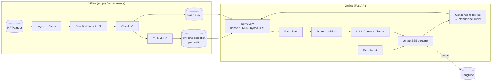

# RAGme — Implementation Plan (v1, for brainstorming)

> Built from your answers in [questions.md](./questions.md). Context: [memory.md](./memory.md) · Tasks: [notes.md](./notes.md)
> Items tagged **🧑‍💻 YOU** are the core RAG pieces you implement. Items tagged **🤖 ME** are scaffolding or plumbing I write.

---

## 0. Reality check first (constraints that shape the plan)

| Constraint | Impact |
|---|---|
| **Weekend sprint**, but a *comprehensive* comparison | Not compatible in full. The weekend delivers the **full pipeline plus a reduced experiment matrix**. Docker, the full corpus, multilingual and agents become follow-up sprints. |
| **M2 Air, 8 GB RAM** | Local LLMs are limited to **~3–4B models** (Qwen2.5-3B / Llama-3.2-3B / Gemma-3-4B via Ollama). Local embedders must be small (≤~150M params). Don't run Docker Desktop, Ollama, a reranker and Vite all at once. |
| **Full corpus ≈ 250M tokens** | Embedding it on a laptop would take days; on the Gemini free tier it would hit rate limits. → **The full-corpus index is a stretch goal**, not something for the weekend. |
| **Dev subset 5–8k docs** | Avg doc ≈ 15k chars, so 6k docs ≈ 90M chars ≈ ~45k–60k chunks at 512 tokens. That is fine locally *if* we cap very long docs (see Brainstorm B2). |
| **Gemini key + OpenRouter** | Gemini Flash = main generator and judge. OpenRouter = a second model family for cross-checks (avoids a judge grading its own answers). |
| **Disliked LangGraph's complexity** | Orchestration is **plain Python**. LangChain is used *selectively* (splitters, and one side-by-side "same pipeline in LCEL" comparison for learning). |
| **Langfuse self-host is heavy** (Postgres + ClickHouse + Redis…) | Use **Langfuse Cloud free tier** for now. Self-hosting can be the Docker lesson later. |

---

## 1. Architecture


`*` = pluggable, selected by a named config (YAML). The same code path serves both experiments and the website.

**Key design rule:** every component implements a tiny interface (`Chunker.split(doc)`, `Embedder.embed(texts)`, `Retriever.search(q, k, filters)`, `PromptBuilder.build(...)`). An experiment is a YAML file that names one implementation per slot.

### Repo layout
```
RAGme/
├── backend/
│   ├── app/            # FastAPI: main.py, routes/, schemas.py, deps.py
│   └── rag/
│       ├── ingest/     # load, clean, subset           🤖 loader · 🧑‍💻 cleaning rules
│       ├── chunking/   # fixed, recursive, semantic…   🧑‍💻
│       ├── embedding/  # local (sentence-transformers), gemini + disk cache   🤖/🧑‍💻
│       ├── index/      # chroma store, bm25            🤖 chroma · 🧑‍💻 bm25
│       ├── retrieval/  # dense, sparse, hybrid RRF, rerank, MMR   🧑‍💻
│       ├── generation/ # llm clients, prompt builder, condense    🤖 clients · 🧑‍💻 prompts
│       └── config.py   # pydantic settings + pipeline registry    🤖
├── experiments/
│   ├── configs/*.yaml  # one file per pipeline variant
│   ├── run_retrieval.py, run_generation.py              🤖
│   └── reports/        # auto-generated markdown + charts
├── evals/
│   ├── seed/seed_eval.csv        # your 10 hand-graded questions
│   ├── golden/synthetic_qa.jsonl # LLM-generated, reviewed
│   ├── metrics.py                # recall@k, MRR, nDCG       🧑‍💻
│   └── judge.py                  # LLM-as-judge + Ragas      🤖
├── frontend/           # React + Vite                        🤖
├── tests/              # pytest unit tests
├── data/               # gitignored: raw/, clean/, subset/, chroma/
├── memory.md · notes.md · plan.md · questions.md
└── pyproject.toml (uv, Python 3.10+)
```

---

## 2. Data plan

1. **Download** the Parquet (~320 MB) once to `data/raw/`.
2. **Clean** 🧑‍💻:
   - strip nav/boilerplate. Heuristic: drop short repeated lines that appear across many pages of the same host, plus known phrases ("Skip to main content", "Sitemap"…)
   - normalize whitespace
   - derive a title when `title` looks like a file path (use the first meaningful line or the URL slug)
   - language detection (`fasttext-langdetect` or `langdetect`)
   - OCR-noise score (ratio of non-dictionary tokens / mixed scripts)
3. **Subset (~6k docs)** stratified by *primary topic × kind*. English only for the main experiments. **Hold out ~500 Indic docs** for the later multilingual sprint.
4. **Store** as `data/subset/docs.parquet` with clean text + metadata (`doc_id, title, url, host, kind, trust, quality, topics, lang, ocr_score`).
5. Write an **ingestion report** (before/after counts, length histogram, how much boilerplate was removed). This is the first artifact for the portfolio.

---

## 3. Experiment strategy — staged sweep, not a full grid

A full grid (5 chunkers × 4 embedders × 6 search modes) = 120 index builds, which is impossible this weekend. Instead we do **coordinate descent**: optimise one stage, freeze the winner, move on. Trade-off: we may miss interactions between stages (e.g. small chunks + BM25). I'll call this out in the report.

All retrieval stages are scored **without an LLM** (cheap, fast) using the golden set:

| Stage | Vary | Hold fixed | Metrics |
|---|---|---|---|
| **A. Chunking** | fixed-512/64 overlap · recursive-512 · sentence-window · semantic · parent-child (small→big) · +title header ("contextual-lite") | embedder = `bge-small-en-v1.5`, dense top-k | Recall@5/10, MRR, #chunks, avg tokens |
| **B. Embedding** | `all-MiniLM-L6-v2` · `bge-small-en-v1.5` · `multilingual-e5-small` · Gemini embedding API | best chunker | + latency, cost, dim |
| **C. Search** | dense · BM25 · hybrid RRF · hybrid + cross-encoder rerank · + metadata filter · + multi-query/HyDE | best chunker + embedder | + p50 latency |
| **D. Generation** | 3–4 system-prompt variants × {Gemini Flash, local 3B} | best retrieval | Ragas (faithfulness, answer relevancy, context precision/recall) + seed human eval |

> **Important gotcha (a good lesson):** chunk IDs change with every chunking strategy, so golden labels must be **doc-level** (`doc_id`) or **char-span-level**, never chunk-level. Otherwise Stage A can't be compared fairly.

---

## 4. Evaluation design

### 4a. Seed set — your 10-question skeleton (built first, by hand)
Spreadsheet `evals/seed/seed_eval.csv`, one row per question. The columns follow your proposal, plus a few extras for analysis:

| Column | Filled by | Meaning |
|---|---|---|
| `id`, `input` | you | The question (mix of factual, multi-part, follow-up, out-of-corpus, ambiguous) |
| `expected_behavior` | you | What a good answer must do / contain / refuse |
| `retrieved_context` | system | Chunk IDs + doc IDs actually retrieved |
| `model_response` | system | The answer |
| `model_critique` | LLM judge | Reasoning against the rubric |
| `model_outcome` | LLM judge | PASS / FAIL (+ per-dimension scores) |
| `human_critique` | you | Your reasoning |
| `human_outcome` | you | PASS / FAIL |
| `alignment` | computed | `model_outcome == human_outcome` |
| `failure_category` | you | retrieval-miss · hallucination · bad-citation · incomplete · wrong-refusal · formatting… |
| **agreement** | computed over the set | % agreement + Cohen's κ between judge and you |

**Why this matters:** this is **judge calibration**. Once the LLM judge agrees with you on the 10 seed questions and then on ~50 judgements (κ ≳ 0.6), you can trust it to grade hundreds of synthetic questions automatically. The judge rubric stays fixed across prompt variants, and that gives us the "general skeleton" for evaluating prompts.

Rubric dimensions (from your ranking): **correctness › faithfulness › citation quality › completeness**. Latency and cost are logged but not graded.

### 4b. Synthetic golden set (expansion)
- Gemini generates questions from ~200 random subset docs, stratified by topic. Each question is labelled with its `doc_id` and answer span.
- Your seed set provides few-shot examples of the questions and behaviour you want.
- You review a sample of ~30. Questions that are bad or ungrounded get dropped.
- Used for Stages A–C (retrieval metrics) and Stage D (Ragas).

### 4c. Observability
- **Langfuse** traces every `/chat` call: condensed query, retrieved chunks, prompt version, response, latency, tokens.
- Your 👍/👎 and comments in the UI become Langfuse **scores**. This is how real failures feed into the failure-category taxonomy.

---

## 5. Online behaviour (product decisions locked in)
- **Multi-turn:** keep the last N turns in memory on the client (no auth or DB). On each turn: **condense** the follow-up and history into a standalone query → retrieve → answer. Condensing is itself a retrieval-quality lever and gets evaluated.
- **Grounding:** answer only from the retrieved context, with **inline citations** `[1]` mapped to source URLs.
- **Out of corpus:** refuse plus suggest where to look (e.g. the relevant ministry or portal host found in near-miss results).
- **Audience:** general public. Plain language, short answers, a reminder to verify with the official source (the data isn't fact-checked and may be outdated).
- **Language:** English now. Hindi and other languages in the multilingual sprint.

---

## 6. Weekend schedule (aggressive)

**Day 1 — Retrieval**
| Block | Work | Owner |
|---|---|---|
| 1 | Repo scaffold, uv env, `.env`, pre-commit, pytest, GitHub repo | 🤖 |
| 2 | Download + clean + subset + ingestion report | 🤖 loader · 🧑‍💻 cleaning |
| 3 | Chunkers (fixed, recursive, sentence, semantic, parent-child) + unit tests | 🧑‍💻 (I review) |
| 4 | Embedders + cache, Chroma store, BM25, RRF | 🤖/🧑‍💻 |
| 5 | Synthetic golden set + retrieval metrics + Stage A/B/C runs | 🤖 runner · 🧑‍💻 metrics |

**Day 2 — Generation, Eval, App**
| Block | Work | Owner |
|---|---|---|
| 6 | LLM clients (Gemini, OpenRouter, Ollama), condense step, prompt builder, 3–4 prompt variants | 🤖 clients · 🧑‍💻 prompts |
| 7 | Seed eval (10 Qs): run, judge, **you grade**, compute agreement | 🧑‍💻 + 🤖 |
| 8 | Stage D: Ragas + judge on the synthetic set → pick the winning prompt | 🤖 |
| 9 | FastAPI `/chat` (SSE), `/search`, `/feedback` + Langfuse | 🤖 |
| 10 | React chat UI with citations (basic design; full design discussion later) | 🤖 |
| 11 | Comparison report + README | 🤖 draft · 🧑‍💻 learnings |

**Follow-up sprints (post-weekend):** ① Docker (Chroma server, compose, maybe self-host Langfuse) → ② full-corpus index with the winning config → ③ multilingual (Hindi queries, multilingual embedder, Indic holdout) → ④ advanced chunking (contextual retrieval, late chunking) → ⑤ agentic retrieval / routing (plain Python, no LangGraph) → ⑥ frontend design polish + demo deploy.

---

## 7. 🧠 Brainstorm — decisions I need from you

**B1. Weekend scope.** Is it OK that the weekend delivers the *pipeline plus a reduced experiment matrix*, with "comprehensive" coming in later sprints? Or would you rather drop the frontend from the weekend and spend the time on more experiments? **We can do the full experiment matrix**

**B2. Long documents.** About 10% of docs are over 17k chars, and the largest is ~900k. Options: (a) truncate to the first ~30k chars · (b) exclude docs over 100k from the subset · (c) keep all. I recommend **(b)** for the subset, so a handful of giant docs don't dominate the chunk count. **(b)**

**B3. Ollama model.** On 8 GB, `qwen2.5:3b` (I lean towards this one: good instruction following) vs `llama3.2:3b` vs `gemma3:4b` (tight). Or skip local generation and use OpenRouter free models as the "cheap" tier? **Use OpenRouter**

**B4. Who writes the 10 seed questions?** You draft them (more realistic), or I propose 15 and you pick 10? **Look at the kind of data, suggest me 15 questions and I will pick 10**

**B5. LangChain learning moment.** Where should it go? My suggestion: after the from-scratch pipeline works, rebuild the *same* pipeline in ~40 lines of LangChain LCEL and compare code, flexibility and results. Doing it that way makes the from-scratch version more valuable. **Do this after we have the from-scratch pipeline working**

**B6. Frontend for the weekend.** A clean but minimal chat UI is enough? Should it also show a "debug panel" (retrieved chunks, scores, prompt version)? That is great for a portfolio demo and for your own debugging. **We can do the full experiment matrix**
